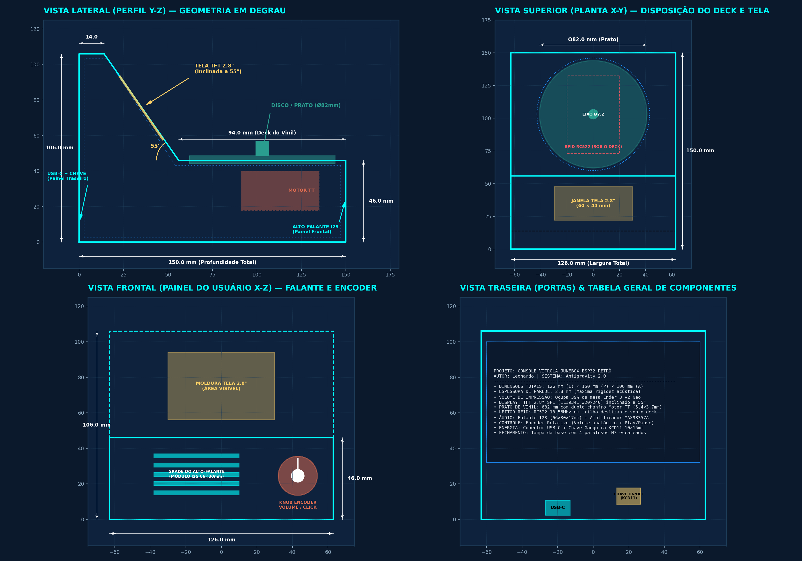

# 🎵 Vitrola Jukebox Retrô — ESP32-S3 & CYD 2-USB

Projeto de engenharia e marcenaria/impressão 3D de uma **Vitrola Jukebox Inteligente** com prato giratório motorizado, leitura de discos via tags RFID (13.56 MHz), reprodução de áudio Hi-Fi com amplificador I2S, exibição gráfica em painel touch com capa de álbum giratória e arquitetura **SD-First Local Playback** com fallback híbrido para nuvem/servidor.



---

## 🌟 Destaques do Projeto

* **Arquitetura Dual-ESP Integrada:**
  * **ESP32-S3 (Base da Vitrola):** Responsável pela leitura de discos RFID, amplificação I2S de alta fidelidade (MAX98357A), ring buffer de áudio de **1 Megabyte em PSRAM Octal**, controle PWM do motor DC N20 com sistema de kick-start anti-inércia e encoder rotativo para volume e play/pause.
  * **CYD 2-USB / ESP32-2432S028R (Painel Gráfico):** Display TFT ST7789 2.8" (320x240) colorido com Touchscreen XPT2046, animação de vinil girando com capa real em 8 quadros RGB565 e slot MicroSD onboard.
* **Reprodução SD-First de Alta Fidelidade (1.5 Mbps UART):**
  * Quando a música cadastrada no disco está gravada no Cartão MicroSD do CYD, ela é transmitida em tempo real via barramento serial de alta velocidade (1.500.000 baud) diretamente para a PSRAM do ESP32-S3 em formato PCM 16-bit 44.1 kHz Mono (88.2 kB/s), sem consumir largura de banda Wi-Fi ou internet!
* **Fallback Híbrido Automático (LAN Local vs Nuvem Global):**
  * Se a música não estiver no Cartão SD, a vitrola faz o streaming contínuo pela rede local (servidor STI) ou pela nuvem mundial (`https://neoface.dev.br/jukebox`).
* **Painel Web Moderno & Spotify Connect:**
  * Interface web responsiva para cadastrar tags RFID com 1 clique, buscar qualquer música ao vivo no catálogo do Spotify e sincronizar instantaneamente o arquivo de discos.
* **Gabinete Retrô & Modelos 3D STL Inclusos:**
  * Peças completas modeladas em CAD para impressão 3D (Gabinete Console, Prato de Vinil, Knob de Volume e Tampas de fechamento).

---

## 🗂️ Estrutura do Repositório

```text
├── 3D/                          # Modelos CAD em formato STL prontos para impressão 3D
│   ├── Vitrola_Console_Gabinete.stl
│   ├── Vitrola_Gabinete_Base.stl
│   ├── Vitrola_Prato_Giratorio.stl
│   ├── Vitrola_Knob_Volume.stl
│   ├── Vitrola_Tampa_Superior.stl
│   ├── Vitrola_Tampa_Fundo.stl
│   └── Desenho_Tecnico_Vitrola_Console.png
├── S3_Base/                     # Firmware do ESP32-S3 (Base, RFID, I2S, Motor, Encoder)
│   └── S3_Base.ino
├── CYD_Display/                 # Firmware da Tela CYD 2-USB (ST7789, Touch, MicroSD)
│   └── CYD_Display.ino
├── C3_Base/                     # Firmware alternativo para ESP32-C3
│   └── C3_Base.ino
├── servidor_jukebox/            # Backend em Python/Flask + Spotify Connect + Áudio Bridge
│   ├── app.py
│   ├── ponte_audio.py
│   ├── discos.json
│   ├── requirements.txt
│   ├── spotify_config.example.json
│   └── templates/
│       └── index.html
├── cyd_std_user_setup.h         # Configuração de pinos TFT_eSPI para a placa CYD
├── gerar_modelo_3d.py           # Gerador paramétrico dos modelos STL via Python
├── gerar_desenho_tecnico.py     # Gerador de plantas e desenho técnico 2D
└── README.md
```

---

## ⚡ Esquema de Ligação & Pinagem

### 1. Comunicação Serial entre os dois ESPs (1.5 Mbps)

| ESP32-S3 (Base) | CYD 2-USB (Display) | Função |
| :--- | :--- | :--- |
| **GPIO 8 (RX)** | **TX (GPIO 1 / CN1)** | Recebe telemetria e blocos de áudio do Cartão SD |
| **GPIO 18 (TX)** | **RX (GPIO 3 / CN1)** | Envia telemetria e comandos de interface |
| **GND** | **GND** | **Referência de terra comum (obrigatório)** |

---

### 2. Pinos do ESP32-S3 (N16R8 - 16MB Flash / 8MB PSRAM)

| Módulo / Periférico | Pino no Módulo | Pino no ESP32-S3 | Observação |
| :--- | :--- | :--- | :--- |
| **Leitor RFID RC522** | SDA / CS | **GPIO 10** | Alimentação estrita de **3.3V** |
| | SCK | **GPIO 12** | Barramento SPI dedicado |
| | MOSI | **GPIO 11** | |
| | MISO | **GPIO 13** | |
| | RST | **GPIO 9** | |
| **Áudio I2S (MAX98357A)** | BCLK | **GPIO 4** | Bit Clock |
| | LRC / WS | **GPIO 5** | Word Select |
| | DIN | **GPIO 6** | Dados seriais de áudio |
| | GAIN | **GND** (ou resistor) | Ajuste de ganho (+12dB ou +9dB) |
| **Motor DC N20 (Ponte H)** | IN1 (PWM) | **GPIO 1** | Controle de velocidade do prato |
| | IN2 | **GPIO 2** | Sentido de rotação / Freio |
| **Encoder Rotativo** | CLK | **GPIO 7** | Canal A |
| | DT | **GPIO 15** | Canal B |
| | SW (Botão) | **GPIO 16** | Clique curto: Play/Pause \| Longo 3s: Modo AP |

---

### 3. Pinos do CYD (Cheap Yellow Display ESP32-2432S028R)

| Função Onboard | Pinos Internos CYD | Observações |
| :--- | :--- | :--- |
| **Display ST7789 2.8"** | MOSI: 13, SCLK: 14, CS: 15, DC: 2 | Barramento HSPI nativo da placa |
| **Backlight Display** | **GPIO 21** | Controle de brilho da tela |
| **Touch XPT2046** | MOSI: 32, MISO: 39, CLK: 25, CS: 33 | SPI compartilhado touch |
| **Slot MicroSD Onboard**| SCK: 18, MISO: 19, MOSI: 23, CS: 5 | Barramento VSPI dedicado ao SD |
| **LED RGB Onboard** | R: 4, G: 16, B: 17 | Nível lógico baixo (LOW = aceso) |

---

## 🛠️ Como Compilar e Gravar os Firmwares

### Pré-requisitos
* **Arduino IDE 2.x** ou **arduino-cli**
* Pacote de placas **esp32 by Espressif Systems** (versão 3.0.x ou superior recomendada)
* Bibliotecas necessárias no Arduino:
  * `TFT_eSPI` (copie o arquivo `cyd_std_user_setup.h` para a pasta da biblioteca ou configure o `User_Setup.h`)
  * `ArduinoJson` (v6 ou v7)
  * `MFRC522` (v1.4.11+)

### 1. Gravando o Display CYD (COM5)
```bash
arduino-cli compile --fqbn esp32:esp32:esp32 CYD_Display/CYD_Display.ino
arduino-cli upload -p COM5 --fqbn esp32:esp32:esp32 CYD_Display/CYD_Display.ino
```

### 2. Gravando o ESP32-S3 (COM14)
> **Importante:** Configure a placa como **ESP32S3 Dev Module**, com **PSRAM = OPI PSRAM** (Octal) e **Flash Size = 16MB**.
```bash
arduino-cli compile --fqbn esp32:esp32:esp32s3:FlashSize=16M,PSRAM=opi,CDCOnBoot=default S3_Base/S3_Base.ino
arduino-cli upload -p COM14 --fqbn esp32:esp32:esp32s3:FlashSize=16M,PSRAM=opi,CDCOnBoot=default S3_Base/S3_Base.ino
```

---

## 🚀 Como Executar o Servidor Backend

1. Instale as dependências:
```bash
cd servidor_jukebox
pip install -r requirements.txt
```
2. Crie seu aplicativo no [Spotify Developer Dashboard](https://developer.spotify.com/dashboard) com o Redirect URI `http://127.0.0.1:3003/callback`.
3. Copie o arquivo de exemplo e insira suas credenciais:
```bash
cp spotify_config.example.json spotify_config.json
```
4. Inicie o servidor:
```bash
python app.py
```
O painel web estará disponível em `http://localhost:3003` ou pelo endereço IP da sua rede local.

---

## 🖨️ Modelos para Impressão 3D

Na pasta [`3D/`](3D/) você encontra os arquivos STL prontos para o fatiador (Bambu Studio, Cura ou PrusaSlicer):
* **`Vitrola_Console_Gabinete.stl`**: Gabinete principal com estilo retrô e alojamento para o alto-falante.
* **`Vitrola_Prato_Giratorio.stl`**: Prato motorizado para suporte do mini disco de vinil com tag RFID embutida.
* **`Vitrola_Knob_Volume.stl`**: Manípulo estilizado para o encoder rotativo de volume.
* **`Vitrola_Tampa_Superior.stl` / `Vitrola_Tampa_Fundo.stl`**: Tampas de fechamento e acesso aos circuitos.

---

## 👤 Autor

* **Leonardo Cardoso** — [@Leonardo-781](https://github.com/Leonardo-781)
* Projeto desenvolvido com foco em arquitetura embarcada, áudio digital e computação física.
